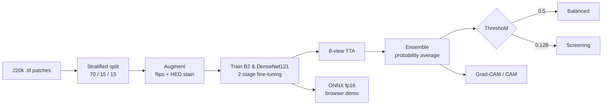

<p align="center">
  
</p>

<p align="center">
  <a href="https://huggingface.co/spaces/saif2556/MetaScan"></a>
  
  
  
</p>

**MetaScan** detects metastatic tumour tissue in 96 × 96 px H&E-stained patches of sentinel lymph-node slides.
It was built as the PBL project of the **Deep Learning** course at Al-Zaytoonah University of Jordan, from the first idea
to a live, explainable web demo that runs entirely in the visitor's browser.

> ⚠️ **Educational project, not a medical device.** MetaScan has not been clinically validated and must not be used for diagnosis.

---

## 🩺 Why it matters

Whether breast cancer has spread to the lymph nodes is a key factor in staging and treatment.
Pathologists search gigapixel slides for small tumour regions under the microscope, which is slow and tiring work where
tiny metastases can be missed. A model that flags suspicious regions can act as a **second reader** and speed up review.

**Task:** binary classification. Input: an RGB patch. Output: P(tumour in the central 32 × 32 region).
**Metric:** ROC-AUC (Kaggle), plus sensitivity / missed tumours for clinical use.

## 🔬 Try it

<table>
<tr>
<td width="62%">

**[huggingface.co/spaces/saif2556/MetaScan](https://huggingface.co/spaces/saif2556/MetaScan)**

- Upload a patch or pick one of **12 sample patches** from the PCam test set (unseen slides), shown with their true label.
- Both networks run **in your browser** with ONNX Runtime Web (WebAssembly). The image never leaves your device.
- 8-view test-time augmentation, two operating points (**balanced 0.5** and **screening 0.128**), per-model scores and a **CAM heat-map** overlay.

</td>
<td align="center"><br/><sub>Scan to open the demo</sub></td>
</tr>
</table>

## 📊 Results

### Kaggle hidden test set (unseen slides)

| Submission | Private AUC | Public AUC | Note |
|---|:---:|:---:|---|
| v1 Baseline CNN | 0.9610 | 0.9572 | built from scratch |
| v1 EfficientNetB0 | 0.9581 | 0.9663 | |
| v1 Ensemble (Baseline + B0) | 0.9678 | 0.9666 | |
| v2 EfficientNetB2 | 0.9624 | 0.9728 | |
| v2 DenseNet121 | 0.9634 | 0.9645 | best single model |
| **v2 Ensemble (B2 + DenseNet121)** | **0.9679** | **0.9722** | **adopted / deployed** |
| v3 4-model rank ensemble | **0.9709** | 0.9725 | best private score |
| v3 Pseudo-label ensemble | 0.9644 | 0.9763 | rejected (over-fitted the test set) |
| v3 PL students + 4 models | 0.9699 | 0.9746 | |

Private ≈ half of the test set, hidden during the competition; it is the score we report. Kaggle ensembles were rank-averaged.

### Adopted ensemble on the internal test set (33,004 patches)

| Operating point | AUC | Accuracy | Sensitivity | Specificity | Missed tumours (FN) | False alarms (FP) |
|---|:---:|:---:|:---:|:---:|:---:|:---:|
| Balanced, threshold 0.5 | 0.9972 | 98.1% | 97.7% | 98.5% | 309 | 304 |
| **Screening, threshold 0.128** | 0.9972 | 95.6% | **99.2%** | 93.1% | **110** | 1,356 |

The screening threshold is the **highest** threshold that still catches ≥ 99% of tumours on the **validation** set.
It cuts missed tumours by **64%**, at the price of more patches sent to the pathologist for review.

> **Why internal AUC (0.997) is higher than Kaggle (0.971):** our split is random per patch, so patches of the same slide can fall
> in both train and test (slide leakage). Kaggle's test uses other slides, with a different stain and scanner appearance.
> We treat Kaggle as the honest estimate.

## 🧠 Models

| | Baseline CNN | EfficientNetB0 | **EfficientNetB2** | **DenseNet121** |
|---|---|---|---|---|
| Version | v1 | v1 | v2 (adopted) | v2 (adopted) |
| Weights | random init | ImageNet | ImageNet | ImageNet |
| Input size inside model | 96 | 128 | 192 | 192 |
| Parameters | 1.24 M | 4.05 M | 7.77 M | 7.04 M |
| Keras layers | 24 | ≈ 240 | 344 | 433 |
| Key idea | plain conv blocks | MBConv + squeeze-excite | compound-scaled B0 | dense connections |
| Hidden activation | ReLU | Swish (SiLU) | Swish (SiLU) | ReLU |
| Output | Dense(1, sigmoid) | Dense(1, sigmoid) | Dense(1, sigmoid) | Dense(1, sigmoid) |
| Kaggle private AUC | 0.9610 | 0.9581 | 0.9624 | 0.9634 |

**Transfer-learning head:** `Resizing → backbone (include_top=False) → GlobalAveragePooling → Dropout(0.3) → Dense(1, sigmoid)`.

**Why this ensemble was deployed:** B2 and DenseNet121 are the two strongest and most different networks (SiLU/MBConv vs ReLU/dense links).
Both were trained with H&E stain augmentation, which makes them more robust to images from other labs.
The demo averages their probabilities, which was validated on the internal test (AUC 0.9972), and the 0.128 threshold was tuned on exactly this ensemble.
The 4-model ensemble scored 0.003 higher on Kaggle, but only through rank averaging of a whole test set, which a single uploaded patch cannot use.

## ⚙️ Training

| Setting | Value |
|---|---|
| Optimizer | Adam |
| Learning rates | 1e-3 head warm-up (backbone frozen) → 1e-4 full fine-tuning |
| Loss | Binary cross-entropy with balanced class weights (≈ 0.84 / 1.23) |
| Batch size / precision | 128 · mixed float16 on 2 × NVIDIA T4 (Kaggle) |
| BatchNorm | frozen during fine-tuning |
| Callbacks | EarlyStopping (val AUC, patience 6), ReduceLROnPlateau (×0.5 after 2 flat epochs), ModelCheckpoint, custom TimeBudget |
| Augmentation | 8 dihedral flips/rotations, **HED stain jitter** (±8% scale, ±0.02 shift per stain), brightness ±0.05, contrast ×[0.9, 1.1] |
| Inference | 8-view test-time augmentation, probability average of both models |
| Best epoch / run time | B2: 10 of 16 (2.6 h) · DenseNet121: 18 of 24 (5.7 h) |

## 🔁 Pipeline



## 🧪 How the project evolved

| Stage | What changed | Kaggle private |
|---|---|:---:|
| Prototype | 50k-image subset, Baseline CNN + EfficientNetB0, pipeline debugged end to end | — |
| v1 | Full dataset, B0 at 128 px, TTA, ensemble | 0.9678 |
| v2 | Bigger backbones (B2, DenseNet121) at 192 px + HED stain augmentation | 0.9679 |
| v3 | 4-model ensemble, clinical threshold, pseudo-labelling experiment | 0.9709 |
| Demo | ONNX fp16 export (0 decision changes on 2,000 patches), static Hugging Face Space | — |

**Lessons:** a bigger model helped on seen slides but not on unseen ones; diversity (ensembles) helped; pseudo-labelling raised the public score but lowered the private one, so it was not adopted.
Every decision was made on validation, never by picking the best Kaggle number.

## 📁 Repository structure

```
MetaScan/
├── notebooks/
│   ├── 01_prototype_50k.ipynb                    # end-to-end prototype on a 50k subset
│   ├── 02_v1_full_dataset.ipynb                  # Baseline CNN + EfficientNetB0, full data
│   ├── 03_v2_effnetb2_densenet121.ipynb          # adopted models
│   ├── 04_v3_ensemble_threshold_pseudolabel.ipynb
│   └── 05_onnx_export.ipynb                      # Keras -> ONNX fp16 for the web demo
├── results/                                      # metrics and Kaggle scores (CSV)
├── docs/
│   ├── MetaScan_Presentation.pptx                # project presentation
│   ├── MetaScan_Code_Documentation.pdf           # annotated code, line by line
│   └── MetaScan_QR.svg
└── assets/banner.svg
```

## ▶️ Reproduce

1. Create a Kaggle notebook and add the competition data **Histopathologic Cancer Detection**.
2. Turn on **GPU T4 × 2** and **Internet** (needed for the ImageNet weights).
3. Run `03_v2_effnetb2_densenet121.ipynb` with *Save & Run All*. It trains both models and saves `.keras` files and predictions (≈ 8–9 h).
4. Add its output as input to `04_v3_…` (ensembles, clinical threshold) and `05_onnx_export.ipynb` (web models).

The notebooks are stored without outputs; all reported numbers are in `results/`.

## ⚠️ Limitations

- Patch-level only. Real practice needs whole-slide aggregation and quality control.
- No slide IDs are available, so internal scores are optimistic; Kaggle is the honest estimate.
- Trained on two Dutch centres (CAMELYON16). Other labs, stains and scanners may perform worse.
- Probabilities are not calibrated for new sites, and the model is not clinically validated.

## 📚 Data & credits

- [Histopathologic Cancer Detection](https://www.kaggle.com/c/histopathologic-cancer-detection) (Kaggle), a de-duplicated version of
  **PatchCamelyon** (Veeling et al., 2018), derived from **CAMELYON16** (Ehteshami Bejnordi et al., 2017). The data is not included in this repository.
- Demo sample patches: PCam test split ([1aurent/PatchCamelyon](https://huggingface.co/datasets/1aurent/PatchCamelyon), CC0).

## 👤 Author

**Saif Khattab · سيف خطاب**, AI student at Al-Zaytoonah University of Jordan

[LinkedIn](https://www.linkedin.com/in/saif-khattab-ai) · [Hugging Face](https://huggingface.co/saif2556) · [GitHub](https://github.com/khattabs691-dev)
